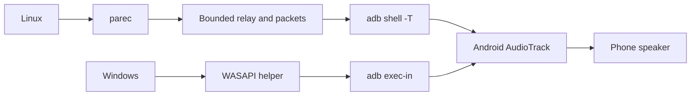

# Internals and development

## Audio path

Android plays stereo PCM at 48 kHz, signed 16-bit little-endian (4 bytes/frame).
The receiver runs through `app_process`; no APK is installed.



| Source | Role |
| --- | --- |
| `src/adb_speaker/cli.py` | Arguments and environment checks |
| `src/adb_speaker/session.py` | Devices, capture, locking, relay, cleanup |
| `src/adb_speaker/protocol.py` | Packets, clock mapping, timestamps |
| `native/android/`, `native/windows/` | Playback receiver and capture helper |
| `scripts/`, `packaging/`, `tests/` | Builds, distribution, verification |

Sessions lock, push the DEX, wait for readiness, then capture. Linux reads `READY`;
Windows polls a `.ready` file. Cleanup closes input, lets playback finish, and removes
receiver files. Disconnected phones need cleanup after reconnecting.

## Buffering and protocol

Linux limits its relay queue to 50 ms, requests a 4 KiB ADB input pipe, and drops old
frames when full. Android skips packets estimated to be over 100 ms old. Windows
and `tone` send raw PCM without these checks. Requested playback buffers are 30 ms
on Linux and 60 ms on Windows; Android reports the actual size.

Linux packets have a 28-byte big-endian header followed by little-endian PCM:

| Field | Type | Value |
| --- | --- | --- |
| `magic` | uint32 | `0x41444231` (`ADB1`) |
| `type` | uint32 | 0 probe, 1 audio |
| `sequence` | int64 | Starts at 0; increases by 1 per packet |
| `timestamp` | int64 | Audio: mapped phone time; probe: host send time (ns) |
| `length` | uint32 | Probe: 0; audio: 4–960 bytes, multiple of 4 |

Five startup probes get `SYNC <sequence> <phone_ns>` replies. Offset is
`phone_ns - (host_send_ns + host_receive_ns) / 2`. Choose the lowest round trip from
five accepted samples: round trip ≤50 ms, age <60 seconds. Two probes refresh every
10 seconds while audio sending pauses and capture drains. Timestamp 0 disables
age rejection when no reliable sample remains.

`--watch` shows throughput (~187.5 KiB/s), buffer size, and cumulative underruns.
Linux adds `packet_age`, `presentation_delay`, receiver drops (`skipped`), and host
drops (`HOST`). Presentation delay estimates the time from the host reading PCM to
Android presenting it, using `AudioTrack.getTimestamp()`. It excludes earlier capture
buffering and acoustic delay; it is not a physical DAC measurement. Clock mapping
can be off by up to half the probe round trip under asymmetric transport delays.
The estimate is `unknown` until timestamps advance, after an underrun or missing/stale
timestamp, and when the computed delay is negative. Reports can stall with audio.
Audio clock drift is not corrected. Dropped audio can click.

## Build and test

Use Python 3.10+. Run `python -m venv .venv`, then activate with
`source .venv/bin/activate` (Linux) or `.venv\Scripts\Activate.ps1` (PowerShell).
From the repository root:

```sh
python -m pip install -e ".[dev]"
python -m unittest discover -s tests -v
python -m ruff check .
python -m ruff format --check .
python scripts/receiver.py check
```

`make help` lists Linux shortcuts. CI tests Python 3.10/3.12 on Linux and Windows,
compiles native code, and builds packages. Host tests exercise the Java delay estimator
when a JDK is available; device tests are manual.

### Windows helper

Install CMake and Visual Studio Build Tools with C++ and the Windows SDK:

```sh
cmake -S native/windows -B build/windows
cmake --build build/windows --config Release
ctest --test-dir build/windows -C Release --output-on-failure
```

Helper: `build/windows/Release/wasapi_capture.exe`. For installed Python packages,
add its folder to PATH. It accepts mono/stereo ≤48 kHz and uses a static MSVC runtime.
Linux builds only conversion tests.

### Android receiver

Use JDK 17 and the Android SDK via `ANDROID_SDK_ROOT`, `ANDROID_HOME`, or `~/Android/Sdk`.
CI uses platform 35 and build-tools 36.0.0.

```sh
python scripts/receiver.py build    # Compile into build/
python scripts/receiver.py bundle   # Update packaged DEX and source marker
python scripts/receiver.py check    # Check source marker, not binary provenance
```

Include updated `src/adb_speaker/assets/` after Java changes. For muted Linux
device tests, stop streaming first:

```sh
ADB_SPEAKER_TEST_SERIAL=SERIAL python -m unittest tests.test_receiver -v
```

### Packages

| Output in `dist/` | Command |
| --- | --- |
| Python wheel and source | `python -m build` |
| Linux x86_64 portable | `make portable` then `make smoke` (Docker) |
| Windows x64 portable | `python packaging/windows/build.py` (Windows) |

Linux bundles Python, ADB, and parec; Windows bundles Python, the WASAPI helper, and ADB.
Packages include checksums and notices. Smoke checks test startup. Releases are
created as drafts for existing tags; publication is manual.

## Contributing

- Describe the problem and how you tested the change. Keep audio tuning separate
  from file moves and explain the expected playback behavior.
- Run the checks above, add regression tests where needed, and update affected docs.
  Run native tests for Java/C++ changes and note platforms or hardware you could not test.
- Rebuild and include the bundled receiver after Android source changes. Keep other
  generated binaries, logs, and local device details out of commits.
- Use plain English in docs. Contributions use MIT; preserve external attribution
  and licenses. Report vulnerabilities through the [security guide](../SECURITY.md).
